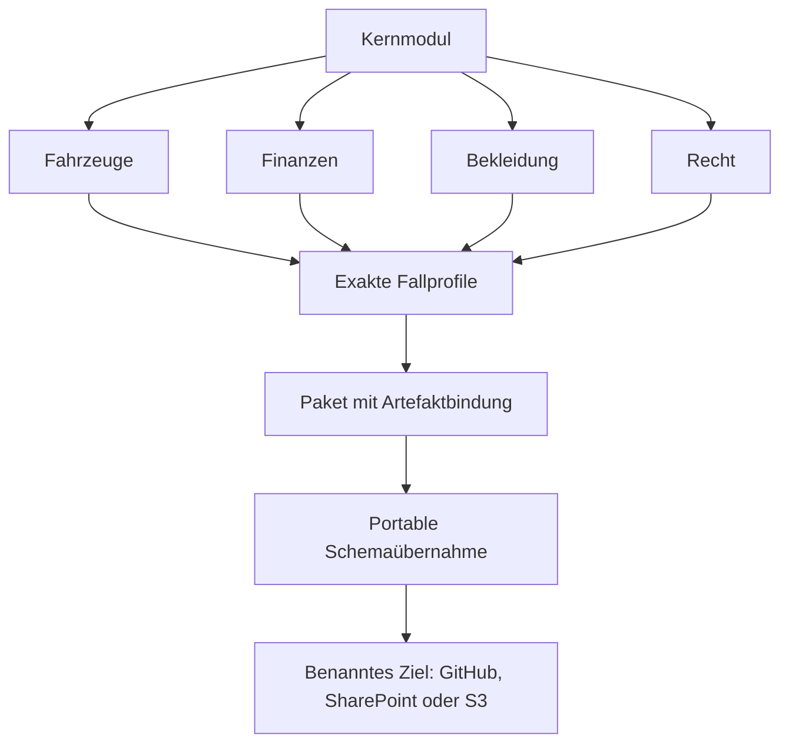

# Fachmodul-, Profil- und Versionsvertrag

Stand: 2026-10-13 · Lizenz: CC-BY-4.0

## Auftrag, Umfang und Review vor Umsetzung

Auftrag: Auto, Aktien, Bekleidung und Erbausschlagung als Referenzen für einen allgemeinen Fachmodul- und Versionsvertrag verwenden. AC-04, AC-10/12/14/19/20 sowie AC-21 bis AC-23 sind der Umfang. Die bisherigen Entwicklungsverträge bleiben erhalten.

Umsetzung: ein geschlossener Metadatenvertrag 0.1.0 für Module, Profile, Pakete und Übernahmen; eigene Begriffsdefinitionen pro Modul mit eindeutiger Verantwortung; exakte Versionsauflösung und abhängige Begriffsnutzung; vier einzelne Fallprofile und ein kombiniertes Pilotprofil; überprüfbare Artefaktidentitäten; offline prüfbarer Export mit Übernahmebindung. Speicherziele sind benennbar, ihr produktiver Betrieb bleibt bei nutzenden Anwendungen.

Risiken: Eine Modulversion könnte mit einer Schemaversion verwechselt werden. Gleiche Begriffs-IDs könnten verschiedene Bedeutungen bekommen. Ein Profil könnte fremde Fachtypen zulassen. Ein beweglicher Git-Zweig oder eine veränderte Datei könnte einen angeblich unveränderten Stand liefern. Ein korrektes Prüfsummenpaket beweist allein keine semantische Kompatibilität.

Alternative gemeinsamer neuer Datensatzvertrag: würde die bestehenden zwei Austauschformen sofort migrieren und den Auftrag um Fachschemaänderungen erweitern. Alternative alleinige Versionsnummern in alten Manifesten: prüft weder Inhalt noch Auflösung und Profilgrenzen. Gewählt wird eine gemeinsame Vertrags- und Paketebene über den beiden überprüften Datenverträgen. Unterschiedliche Datenformen sind ausdrücklich gekennzeichnet; es wird kein gemeinsamer produktiver Rechtsdatensatz behauptet.

Plan: Metadatenschemas und fachliche Verantwortungen ausarbeiten; Kern-/Fahrzeug-/Finanz-/Bekleidungs-/Rechtsmodule mit exakten Abhängigkeiten anlegen; Profile und synthetische Einzelproben erstellen; Abhängigkeitsgraph, Begriffsverantwortung und Profilgrenzen ausführbar prüfen; kanonische SHA-256-Artefaktbindung und externe Übernahme implementieren; alle bisherigen Erwartungen und RDF-Rückwege wiederverwenden; negative Versions- und Exportfälle prüfen; Review und CI vor Merge abschließen.

Review vor Code: Geteilte Aussagebegriffe gehören mit allgemeiner Bedeutung zum Kern; beteiligte Fachtypen bleiben im jeweils gewählten Profil begrenzt. Kein Fachmodul darf eine bereitgestellte ID überschreiben. Die bestehende semantische Datenvalidierung bleibt für ihre jeweilige Datenform verbindlich. Paketprüfungen ersetzen sie nicht. Der Export muss alle Laufzeit-/Schema-/Beispielabhängigkeiten erhalten und in einem separaten Verzeichnis erneut geprüft werden. Quellrevision und Artefaktbindung sind verschiedene Nachweise. Paketdatei und Übernahmedatei dürfen keine gegenseitige Prüfsummenschleife erzeugen.

## Identität und Verantwortung

| Ebene | Inhalt und Version |
| --- | --- |
| Kernmodul | Allgemeine Identität, Sprachwerte, Zeit und geteilte Aussagebegriffe; Modulstand unabhängig vom Datensatzschema |
| Fachmodul | Eigene Entitäts-/Aussagebegriffe sowie ausdrückliche Nutzung gemeinsamer Begriffe und Datenverträge |
| Fallprofil | Exakte Modulstände, gewählte Datenform, zulässige Fachtypen, Referenzdaten und Prüferwartungen |
| Paket | Exakte Modul-/Profilmanifeste und alle benötigten Artefakte samt SHA-256 |
| Übernahme | Paket-ID, Version, kanonische Paketprüfsumme und benanntes Speicherziel |

Module besitzen stabile IDs und versionierte Verzeichnisse. Kern, Finanzen und Bekleidung erhalten für den allgemeinen Manifestvertrag einen neuen Modulstand 0.2.0; die ursprünglichen 0.1.0-Manifeste bleiben unverändert. Fahrzeuge und Recht beginnen mit 0.1.0. Die Datensatzschemata behalten ihre bisherigen IDs und Versionen. Der neue Paket-/Manifestvertrag beginnt mit 0.1.0 und ist ein Entwicklungsvertrag, kein produktives Release.

Begriffsdefinitionen besitzen ID, Art und sprachabhängige Bezeichnungen. Kernbegriffe `kauf`, `eigentum` und `bewertung` werden gemeinsam genutzt. Fachprofile begrenzen die zugelassenen Entitäts- und Aussagetypen anhand ihrer Modulabhängigkeiten; die vorhandenen Datensatzvalidatoren prüfen zusätzlich Beteiligte, Zeit, Revisionen und Berechnungsgrundlagen. Recht bindet ausdrücklich den synthetischen Erbausschlagungsvertrag; seine Feldkennzeichen werden nicht als bereits allgemeingültige Rechtsontologie ausgegeben.

Ein Abhängigkeitsgraph darf weder fehlende Versionsstände noch Zyklen enthalten. Ein Profil wählt höchstens einen Stand je Modul-ID und enthält die vollständige transitive Abhängigkeit. Eine Begriffsnutzung muss innerhalb dieser Abhängigkeiten auf genau eine Definition zeigen. Eine neue unabhängige Anwendung kann eigene IDs und einen eigenen Namensraum ergänzen; sie überschreibt keine zentrale Definition.

Ein Paket ist eine konkrete Auswahl und führt ebenfalls höchstens einen Stand je Modul- oder Profil-ID. Andere historische Auswahlen sind eigene Pakete. Die Begriffsbedeutungen werden pro Modul gepflegt; die bestehende Pilotregeldatei bleibt der unveränderte ausführbare Vertrag ihres Datensatzstands. Ein deklariertes neues Schema oder eine neue Abbildung wird erst mit einer ausdrücklich unterstützten Prüffähigkeit ausführbar. Die Metadatenprüfung allein behauptet diese Fähigkeit nicht.

Die implementierten Pfade sind `vertraege/module/0.1.0/`, `modelle/kern/0.2.0/`, `modelle/fachmodule/<fach>/<version>/`, `profile/anwendungsfaelle/versioniert/0.1.0/` und `pakete/0.1.0/`. Das bewegliche `register/paketentwurf.json` ist eine Autorenhilfe; `register/pakete.json` verweist auf festgehaltene Paketstände. IDs bleiben unabhängig vom Ablagepfad.

## Versionen und Kompatibilität

Grundlage: [Semantic Versioning 2.0.0](https://semver.org/lang/de/) unterscheidet kompatible Korrekturen, kompatible Ergänzungen und inkompatible Änderungen und verbietet die Änderung veröffentlichter Versionen. Versionen unter 1.0.0 sind Entwicklungsstände. Hier unterstützt der erste Metadatenvertrag bewusst ausschließlich Zahlenstände `MAJOR.MINOR.PATCH`; Vorveröffentlichungs- und Build-Suffixe werden zurückgewiesen.

Eine gleiche Versionsidentität mit abweichendem Artefaktinhalt ist keine zulässige Aktualisierung. Neue Bedeutungen, Pflichtangaben, Kardinalitäten, Einheiten oder Ausgabeformen werden als Vertragsänderung geprüft. Exakte Versionsbindung bleibt verpflichtend; keine Auflösung über `latest`, Bereiche oder einen beweglichen `main`-Verweis. Es gibt keinen automatischen Wechsel eines Verbrauchers.

Kompatibilität ist gerichtet und umfasst Eingabeannahme, Ergebnisbedeutung und Abbildung. Die Prüfroutine vergleicht Paket-/Artefaktidentitäten und meldet Änderungen; unterschiedliche Inhalte gelten zunächst als `pruefung_erforderlich`. Sie bescheinigt semantische Kompatibilität nicht aus Versionsnummern oder wenigen Beispielen. Der Nachweis gleicher Eingaben und Erwartungen über alle vorhandenen Fälle ist eine begrenzte Regressionsevidenz. Neue Versionsabbildungen werden als eigene, geprüfte Artefakte angelegt; der aktuelle Kern erhält keine Sonderfälle für jede frühere Anwendung.

JSON-Schema-Referenzen werden offline über registrierte `$id`-Ressourcen aufgelöst. [JSON Schema: Strukturierung](https://json-schema.org/understanding-json-schema/structuring) trennt Ressourcenidentität und Ablageort. Geschlossene Profile bleiben geschlossen; [zusätzliche Eigenschaften](https://json-schema.org/understanding-json-schema/reference/object) können deshalb trotz optionaler Definition für vorhandene Verbraucher inkompatibel sein.

## Artefaktbindung und externe Übernahme

Paketartefakte besitzen eindeutige, repositoryrelative Pfade ohne `..`, absolute Pfade oder fremde URLs. JSON wird für SHA-256 nach einer hier definierten lokalen Kanonisierung verarbeitet: Objektfelder sortiert, keine Einrückung, UTF-8; Arrayreihenfolge bleibt erhalten. Textartefakte verwenden UTF-8 mit vereinheitlichten Zeilenenden. Das ist ein Projektvertrag, keine Behauptung von RFC-8785-Konformität. Prüfsummen sind Integritätsnachweise; Herkunft braucht zusätzlich einen vertrauenswürdigen Commit beziehungsweise eine vertrauenswürdig erhaltene Paketbindung.

Der Paketinhalt enthält Referenzen auf Modul-/Profilmanifeste und deren Artefakte. Das Paketmanifest bindet seine Artefakte; die Übernahmedatei bindet das Paketmanifest. Der Paketinhalt bindet weder sich selbst noch eine erzeugte Übernahmedatei. So bleibt die Identität reproduzierbar und ohne Prüfsummenschleife.

Die Zielarchitektur kann `github`, `sharepoint` oder `s3` heißen. Der Export kopiert ausschließlich die ausdrücklich aufgelisteten Schema-, Code-, Lizenz- und synthetischen Referenzartefakte in ein neues Verzeichnis. Er führt keine Anbieter-API aus, erstellt keine produktiven Speicher und überträgt keine Echtdaten. Clone/Fork und eine portable Kopie sind zulässige Transportwege; die Übernahmebindung bleibt gleich. Zugangsdaten, Bucket-/Tenantnamen oder echte Speicheradressen werden hier nicht benötigt.

Die Produktivanwendung verwendet das Schema für ihre eigenen Daten außerhalb dieses Repositories. Das Projekt bleibt die zentrale Pflegequelle. Ein Backendwechsel verändert weder Personenidentität noch fachliche Zeit oder Sprachwerte. Der Export ist ein Schema-/Prüfpaket, keine produktive Datenmigration und keine fertige GitHub-/SharePoint-/S3-Anbindung.

Der Paketgenerator erstellt nur neue, höhere Paketstände, prüft die Referenzprofile vor dem Schreiben in einer isolierten Kopie und vergleicht registrierte frühere Bindungen. Bestehende Modul-/Profilmanifeste bleiben unverändert, auch wenn der neue Stand sie nicht mehr auswählt. Wiederverwendete Manifestversionen dürfen ihre gebundenen Artefakte nicht ändern. Der Export erhält die aktive Paketpfadangabe; spätere Versionen werden beim Start einer portablen Kopie aus `uebernahme.json` ausgewählt.

Frühere ausführbare Inhalte werden aus dem jeweiligen Git-Commit oder einer unveränderten portablen Kopie verwendet. Der aktuelle Checkout trägt keine Laufzeitsonderfälle für jede frühere Anwendung und ist kein gleichzeitiges Archiv verschiedener Inhalte am selben Dateipfad. Ein produktiver Verbraucher bindet zusätzlich zum Paketinhalt den vertrauenswürdigen Quellcommit seines Clones/Forks; dieser erste Entwicklungsstand erstellt keine Tags oder produktive Releases.

Die [Paketbenutzung](../../../pakete/0.1.0/README.md) nennt die Befehle. Ein Vergleich mit einer anderen Übernahme erfolgt über `python scripts/pruefe_module.py --vergleich <datei>`. Unterschiedliche Versionsbindungen liefern `PRUEFUNG_ERFORDERLICH` und Exitcode 2. Gleiche Versionsidentität mit anderer Prüfsumme ist ein Fehler. Ein offener Vergleich wird nicht als bestandener Kompatibilitätsnachweis ausgegeben.

## Prüfplan

Positive Prüfungen: alle fünf Module und fünf Profile auflösen; Auto, Aktien, Bekleidung und Erbausschlagung einzeln mit synthetischen Eingaben und vorhandenen fachlichen Erwartungen prüfen; gemeinsames Pilotprofil unverändert validieren; Erwartungen nach RDF-Rückwegen erhalten; portables Paket außerhalb seiner bisherigen Ablage prüfen; alle drei Zielkennzeichen zulassen.

Negative Prüfungen: falsche Versionsstände, fehlende/transitiv ausgelassene Abhängigkeiten, Zyklen, doppelte oder fremd überschriebene Begriffe, nicht freigegebene Fachtypen, veränderte Artefakte, unbekannte Profil-/Schema-IDs, Pfadüberschreitungen und falsche Übernahmebindung abweisen. Ein geschlossenes altes Schema muss ein neu ergänztes Feld weiterhin zurückweisen; eine Versionsnummer allein darf diese Änderung nicht kompatibel nennen.

Umsetzungsreview: Die aktive Paketbindung erhielt einen eigenen relativen Pfad, damit eine portable Kopie nicht still auf 0.1.0 zurückfällt. Die Anzeige übernimmt außerdem das gebundene Speicherziel, solange keines ausdrücklich neu gewählt wird. Die Veröffentlichungsprüfung schützt auch abgelöste Manifeststände. Der Vergleich meldet fehlenden Kompatibilitätsnachweis als offenen Status. Eine zunächst falsche Methodenzuordnung in der Bekleidungs-Erwartung wurde anhand der ursprünglichen synthetischen Eingabe korrigiert; numerische Erwartungen werden weiterhin unabhängig vorgegeben.

Lokale Evidenz: fünf Module, fünf Profile und 29 eindeutige Begriffszuständigkeiten geprüft. Drei Einzelproben enthalten 17 zusätzliche unabhängige Fragen; bisheriger Gesamtpilot und Erbausschlagungsfälle bestehen weiterhin einschließlich Turtle-/JSON-LD-Rückwegen. Die Tests prüfen auch die CLI aus einer separaten portablen Kopie, spätere aktive Paketversionen, alle drei Zielkennzeichen und offene Vergleichsergebnisse. Insgesamt 76 Testmethoden sind erfolgreich, davon 22 neue.

## Nächster Schritt

Weitere Fachdefinitionen auf dem geprüften Vertrag ergänzen; bei einem tatsächlichen Versionswechsel einen gerichteten Migrationsvertrag mit unabhängigen Erwartungen erstellen.
